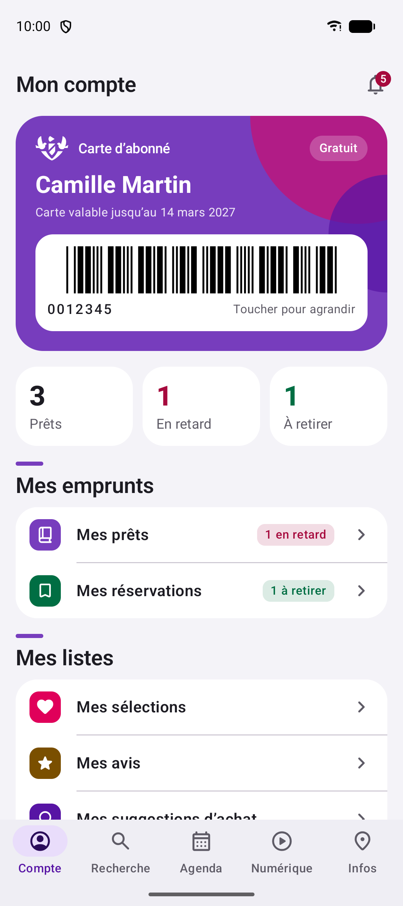
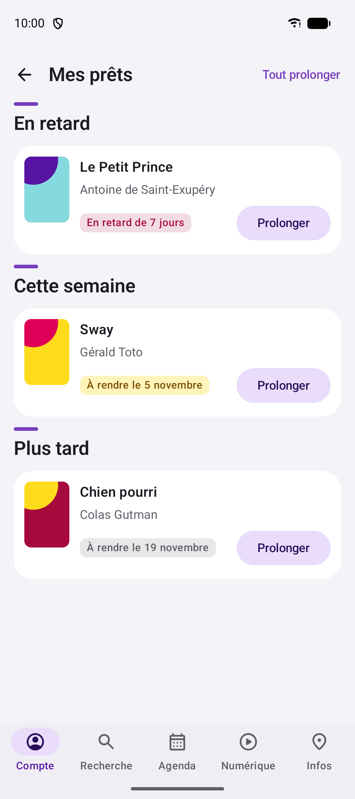
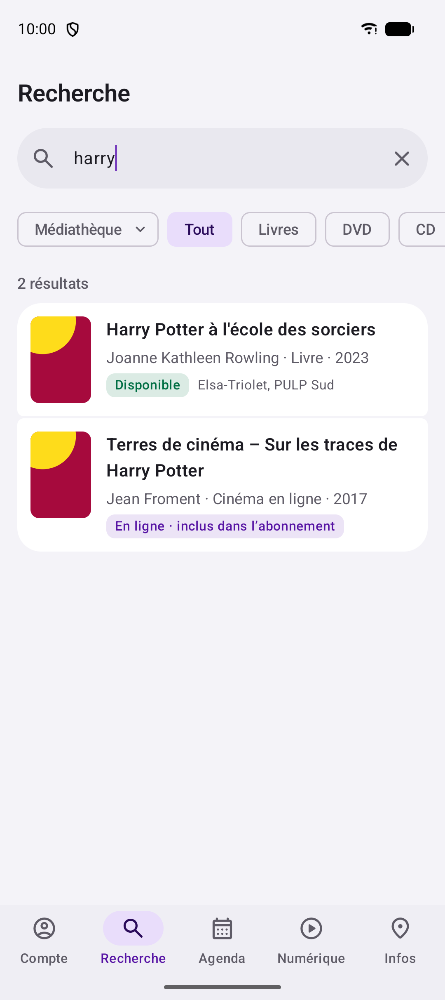
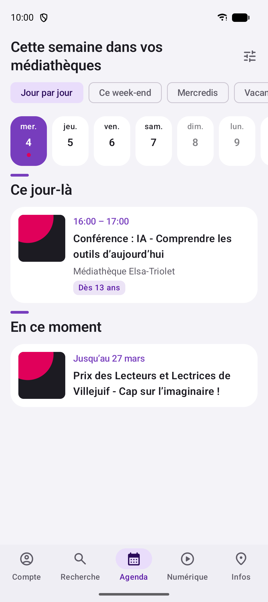
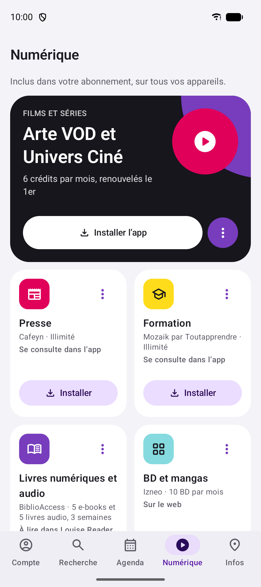
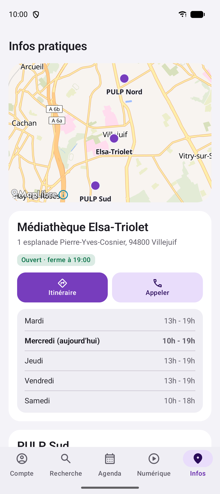
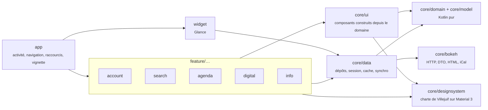

<div align="center">


# Médiathèque pour Android

**Les médiathèques de Villejuif dans la poche.**<br>
Vos prêts, vos réservations, l'agenda, le catalogue et la médiathèque numérique, dans une app Android native.


</div>

<p align="center">
  
  
  
  
  
  
</p>

> [!IMPORTANT]
> **Projet personnel et non officiel.** Cette app n'est ni éditée, ni validée, ni soutenue par la Ville de Villejuif ou son réseau de médiathèques. Elle s'appuie sur le portail public [mediatheque.villejuif.fr](https://mediatheque.villejuif.fr/). Le nom, le blason et la charte graphique de Villejuif appartiennent à la Ville.

---

## Pourquoi

Le portail des médiathèques de Villejuif est complet, mais pensé pour un ordinateur. *Médiathèque* reprend ce qu'on y fait le plus souvent depuis un téléphone : vérifier ce qu'il faut rendre, prolonger un prêt, réserver un livre, voir ce qui se passe mercredi, ouvrir un film du catalogue numérique. Tout se fait en quelques gestes, aux couleurs de la ville et dans le respect de Material 3.

C'est le portage de l'[app iOS](https://github.com/romainbiard/villejuif-mediatheque), écran par écran, mais pas une copie : la navigation, les composants et les réflexes sont ceux d'Android. Le [plan de portage](docs/PLAN-PORTAGE.md) détaille les choix.

## Fonctionnalités

### 👤 Mon compte
- **Carte d'abonné** en Code 39, comme la carte en plastique. Elle s'affiche en plein écran pour le comptoir, avec la luminosité au maximum, et peut pivoter d'un demi-tour.
- **Prêts** regroupés par échéance (en retard, cette semaine, plus tard), à prolonger un par un ou tous d'un coup.
- **Réservations** avec le lieu de retrait, et annulation après confirmation.
- **Sélections, avis, suggestions d'achat (avec scan de l'ISBN), informations personnelles et réglages.**
- **Connexion** avec le gestionnaire d'identifiants d'Android (Credential Manager) et le scan du code-barres de la carte, puis **empreinte ou visage** pour les fois suivantes.
- **Rappels** avant la date de retour, alerte quand une réservation est disponible, et agenda de la semaine le lundi matin, chacun sur son propre canal de notification. L'app explique pourquoi elle demande l'autorisation avant que la fenêtre d'Android n'apparaisse.

### 🔎 Recherche
- Tout le catalogue, avec des filtres par type de document et par médiathèque.
- La **disponibilité en temps réel** de chaque exemplaire (en rayon, en prêt, date de retour), et pas le statut de la nuit précédente.
- Une fiche détaillée pour chaque œuvre, et la **réservation** avec le choix du lieu de retrait.
- Des tuiles *Explorer* pour démarrer : nouveautés, films, musique, e-books, livres audio, films en ligne.

### 📅 Agenda
- Les animations des trois médiathèques, jour par jour.
- Des filtres par lieu, type d'animation et public.
- L'ajout à l'agenda du téléphone, et le partage.

### ▶️ Numérique
- Arte VOD, Cafeyn, Mozaik, BiblioAccess, Izneo, Eurêka et musicMe, déjà inclus dans l'abonnement.
- **Ouvrir ou installer** : l'app sait si l'app du partenaire est installée. Si oui, elle l'ouvre directement. Sinon, elle la présente puis ouvre sa fiche Google Play.
- La connexion aux services web se fait par le portail : pas de deuxième mot de passe à retenir.

### 🏛️ Infos pratiques
- Les trois médiathèques (Elsa-Triolet, PULP Nord, PULP Sud) sur une carte MapLibre, avec leurs horaires.
- Le statut **« Ouvert » ou « Fermé · ouvre mardi à 13:00 »**, calculé en direct.
- Itinéraire, appel ou message en un geste.

### Et aussi
| | |
|---|---|
| 📱 **Widget** | « Prochains retours » sur l'écran d'accueil (Jetpack Glance), mis à jour par la synchronisation en arrière-plan |
| ⚡ **Raccourcis** | appui long sur l'icône : *Ma carte*, *Rechercher*, *Agenda* ; et une vignette *Ma carte* dans les Réglages rapides |
| 🖥️ **Tablettes et pliables** | rail de navigation, recherche et fiche côte à côte, raccourcis clavier (Ctrl+F, Ctrl+1…5) |
| 🎨 **Android moderne** | bord à bord, retour prédictif, icône à thème, langue de l'app réglable dans les paramètres d'Android |
| 📶 **Cache** | l'agenda, les horaires et les recherches récentes restent affichés quand le réseau flanche |
| ♿ **Accessibilité** | TalkBack (titres, états et annonces), texte jusqu'à 200 %, contrastes AA et contraste renforcé, mode sombre, portrait et paysage |

## Comment ça marche

Il n'y a **pas de serveur** : l'app parle directement au portail des médiathèques, qui tourne sous Bokeh, un portail open source de bibliothèques.

| Besoin | Source |
|---|---|
| Recherche | `…/recherche/simple/…/format/json`, l'API JSON publique de Bokeh |
| Disponibilité en temps réel | `/noticeajax/availability` et `/noticeajax/exemplaires` |
| Agenda | la page HTML de l'agenda (une seule requête), puis l'iCal de chaque événement pour le détail |
| Horaires | les pages HTML des médiathèques |
| Compte | `/api/user/*` avec le cookie de la session web, obtenu par le formulaire de connexion du portail |
| Numérique | `/modules/{service}`, qui renvoie l'URL de connexion (SSO) chez le fournisseur |

Tout ce qui dépend du format du site (DTO, analyse du HTML avec Jsoup, iCal) est isolé dans `core/bokeh`. Si le portail change, seule cette couche bouge. Le défi anti-robot du portail est résolu une fois, dans une web view hors écran au profil isolé.

## Architecture

Jetpack Compose et Material 3, **ViewModel** et `StateFlow`, injection de dépendances avec **Hilt**, navigation avec **Navigation 3** et les mises en page adaptatives de Material. Une seule activité, et des modules par couche, comme le package Swift de l'app iOS.



```
.
├── app/                     # activité unique, navigation adaptative, écran de lancement, raccourcis, vignette
├── core/
│   ├── bokeh/               # transport et formats du portail (Kotlin pur, sauf le défi anti-robot)
│   ├── model/               # modèle du domaine (Kotlin pur)
│   ├── domain/              # règles métier (Kotlin pur)
│   ├── data/                # dépôts, session, cache, synchronisation, données de démonstration
│   ├── datastore/           # réglages et coffre des identifiants (Tink + Android Keystore)
│   ├── notifications/       # canaux, rappels et tâches de fond (WorkManager)
│   ├── designsystem/        # charte de Villejuif sur Material 3, composants, icônes
│   ├── ui/                  # composants construits depuis le domaine : carte, erreurs, état vide
│   ├── testing/             # fakes et fixtures partagés par les tests
│   └── screenshottesting/   # thèmes, tailles de texte et fenêtres des captures d'écran
├── feature/                 # un module par destination : account, search, agenda, digital, info
├── widget/                  # widget « Prochains retours »
├── baselineprofile/         # générateur du profil de référence
├── build-logic/             # plugins Gradle de convention
├── docs/                    # plan de portage, confidentialité, fiche Google Play, images du README
└── scripts/                 # contrôle des données personnelles, ajout d'icônes Material Symbols
```

- **ViewModels** : ils exposent un état immuable en `StateFlow` et des intentions, et reçoivent leurs dépendances par Hilt.
- **Écrans** sans logique : ils affichent l'état et relaient les actions. Chaque écran a une fonction « contenu » sans ViewModel, utilisée par les aperçus et les captures.
- **Dépôts** derrière des interfaces, avec une implémentation réelle et une de démonstration, choisie par la variante de build.
- **Persistance** : un cache des données publiques, un instantané du compte partagé avec le widget, et les identifiants chiffrés. Rien d'autre.

## Démarrer

**Prérequis** : Android Studio (version récente, avec le SDK Android 37).

1. Ouvrez le dossier du projet dans Android Studio (*File › Open*) et laissez Gradle se synchroniser.
2. Choisissez la configuration **Médiathèque** et un appareil virtuel ou un téléphone, puis ▶︎.

L'app existe en deux variantes (*Build › Select Build Variant*) :

| Variante | Données | Usage |
|---|---|---|
| `prodDebug` (par défaut) | le portail des médiathèques | l'app réelle, avec votre carte |
| `demoDebug` | l'abonnée fictive Camille MARTIN, en mémoire | essayer l'app sans carte, captures d'écran, tests d'interface |

La démo s'installe à côté de l'app réelle (« Médiathèque démo ») et n'est jamais publiée : seule `prodRelease` part sur Google Play. Sa version release ne sert qu'au profil de référence et aux vérifications R8.

En ligne de commande :

```bash
./gradlew installProdDebug
```

```bash
./gradlew installDemoDebug
```

L'identifiant de l'app versionné est neutre (`com.example.mediatheque`). Pour publier sous votre propre identifiant, ajoutez `mediatheque.applicationId=…` dans `local.properties` (ignoré par git) ou définissez la variable `MEDIATHEQUE_APPLICATION_ID`.

Sans compte, la recherche, l'agenda, les infos pratiques et la présentation du numérique fonctionnent. Pour l'espace abonné, il faut une carte des médiathèques de Villejuif, ou la variante de démonstration.

### Tests

Plus de 200 tests unitaires, sur des fixtures JSON, HTML et iCal tirées du portail réel et anonymisées. Les dépôts tournent pour de vrai contre un faux portail (MockWebServer) : connexion, reconnexion après expiration, prolongation, réservation.

```bash
./gradlew testDebugUnitTest
```

Les **captures d'écran** (Roborazzi sur Robolectric) dessinent chaque écran en clair, en sombre, avec le texte à 200 % et sur tablette, et les comparent aux images de référence de `feature/*/src/test/screenshots/`. Après un changement voulu, réenregistrez-les, puis relisez les images avant de les commiter :

```bash
./gradlew recordRoborazziDebug
```

Les **parcours instrumentés** (`app/src/androidTestDemo/`) pilotent la variante de démonstration comme un lecteur, avec les contrôles d'accessibilité d'Espresso (libellés, cibles tactiles, contrastes) à chaque écran. Sur un émulateur lancé :

```bash
./gradlew connectedDemoDebugAndroidTest
```

Ou sur l'appareil géré par Gradle qu'utilise la CI :

```bash
./gradlew pixel6Api35DemoDebugAndroidTest
```

### Style et qualité

```bash
./gradlew spotlessCheck lint
```

- **Format** : ktlint via Spotless (`./gradlew spotlessApply` corrige).
- **Lint** Android strict, avec les règles Compose.
- **Profil de référence** (démarrage et parcours principaux, enregistrés sur la démo) : `./gradlew :app:generateDemoReleaseBaselineProfile` avec un émulateur lancé. Le profil est commité dans `app/src/demoRelease/generated/baselineProfiles/` et livré avec toutes les variantes.
- **Build release** (R8 complet, ressources réduites, journaux supprimés) : `./gradlew :app:assembleProdRelease`.
- **Avant chaque commit** (hook dans `.githooks/`, activé par `git config core.hooksPath .githooks`) : identité git locale obligatoire, recherche de secrets ([gitleaks](https://github.com/gitleaks/gitleaks)) et de données personnelles (`scripts/check-personal-data.sh`). La CI GitHub Actions refait les mêmes contrôles.

## Confidentialité

- **Aucun serveur intermédiaire, aucun traceur, aucune statistique.** Les données vont seulement de votre téléphone au portail des médiathèques.
- Les identifiants restent sur l'appareil, **chiffrés avec une clé de l'Android Keystore**, et ne partent jamais dans les sauvegardes. Avec le verrouillage biométrique, l'app se verrouille au lancement et après deux minutes en arrière-plan.
- Le cache ne contient que des **données publiques** (agenda, horaires, recherches). Les données du compte sont effacées à la déconnexion, widget compris.
- Les URL de connexion aux services numériques peuvent contenir des données personnelles : elles sont résolues au moment du tap et **jamais journalisées**.

Le détail est dans la [politique de confidentialité](docs/confidentialite.md).

## Publication

La préparation de la fiche Google Play (textes, déclarations, captures, signature, étapes restantes) est dans [docs/play](docs/play/CHECKLIST.md). Rien n'est publié depuis ce dépôt.

## Licence

Code sous licence [MIT](LICENSE). Icônes : [Material Symbols](https://github.com/google/material-design-icons) de Google, sous licence Apache 2.0 (ajoutées par `scripts/material_symbol.py`). Le nom, le blason et l'identité visuelle de la Ville de Villejuif, ainsi que les marques des services numériques cités, appartiennent à leurs propriétaires respectifs.
